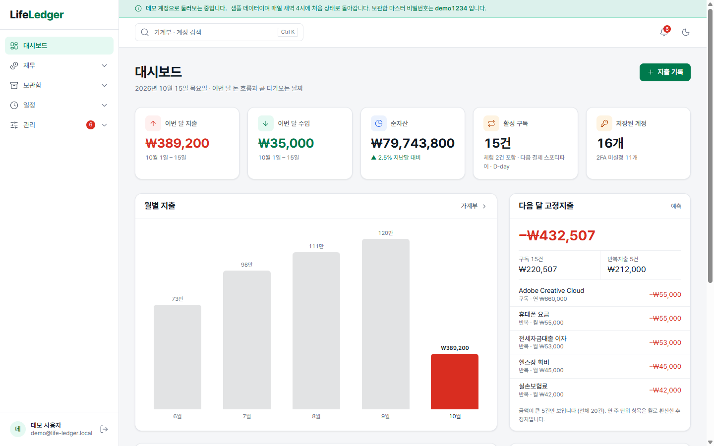
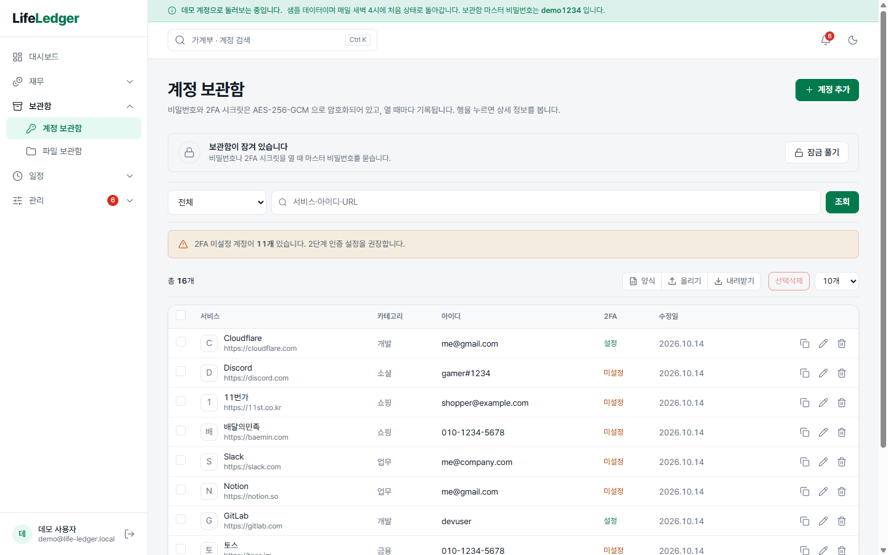
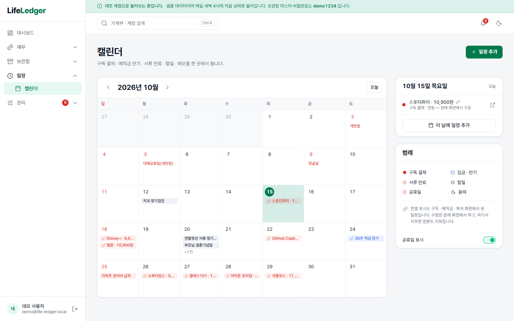
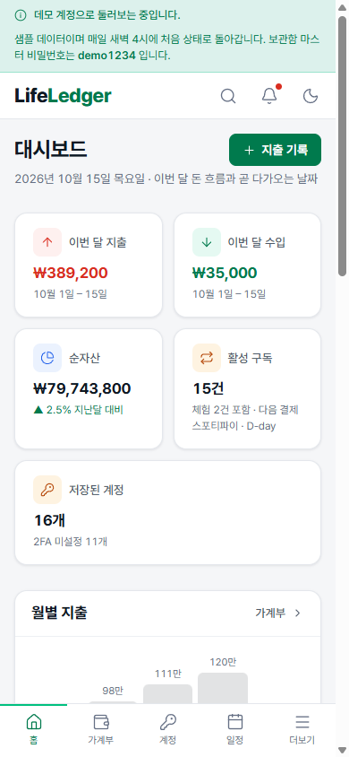
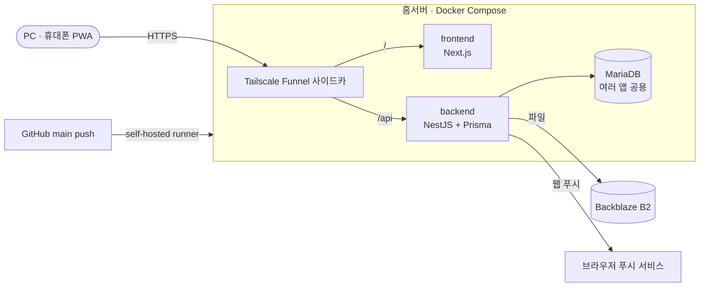

# LifeLedger

돈 · 계정 · 파일 · 일정을 한곳에 두는 1인용 생활 장부. 홈서버에서 직접 운영하며 매일 쓰는 앱이다.

**데모: <https://lifeledger-demo.tailba78c1.ts.net>** — 로그인 화면의 "데모로 둘러보기"를 누르면 샘플 데이터가 든 계정으로 들어간다. 계정 보관함 잠금 비밀번호는 `demo1234` 이고, 데이터는 매일 새벽 4시(KST)에 처음 상태로 돌아간다.

| 영역 | 하는 일 |
| --- | --- |
| 가계부 | 수입 · 지출 · 예적금 · 투자(국내 · 해외 시세 자동 갱신, 반복 매수) |
| 구독 · 자산 종합 | 구독 결제일 관리, 월별 순자산 추이 |
| 계정 보관함 | 사이트 계정 · 비밀번호 · TOTP · 백업 코드를 암호화해 보관, 열람할 때마다 기록 |
| 파일 보관함 | 서류 파일 (Backblaze B2) |
| 캘린더 | 직접 넣은 일정 + 구독 결제일 · 예적금 만기 · 공휴일 |
| 보안 · 알림 | 로그인 기기 · 세션 관리, 마스터 잠금, 결제 · 만기 알림(웹 푸시) |

## 화면



| 계정 보관함 | 캘린더 | 휴대폰 (PWA) |
| --- | --- | --- |
|  |  |  |

## 구조



- 화면과 API 를 한 주소(`/` · `/api`)로 묶어 CORS · 쿠키 설정이 단순하다.
- 데모는 같은 코드를 `DEMO_MODE` 로 따로 띄운 인스턴스다. DB · 파일 버킷 · 주소가 운영과 완전히 분리돼 있다 ([docker-compose.demo.yml](docker-compose.demo.yml)).
- 암호화 · 인증 · 예약 작업 · 알림 같은 공통 부분은 여러 개인 프로젝트가 같이 쓰는 라이브러리 young-core(`@leejinyoung-kr/core-*`)로 뽑아 두었다. 개인용이라 레포는 비공개이고, 설계와 핵심 코드는 [docs/core-libraries.md](docs/core-libraries.md) 에 요약했다.

| 구분 | 기술 |
| --- | --- |
| Frontend | Next.js 16 (App Router) · React 19 · TypeScript · Tailwind CSS v4 · TanStack Query · PWA |
| Backend | NestJS 11 · Prisma 7 · MariaDB 11 |
| 인증 | Google OAuth · 이메일 인증 코드 (허용 목록) + JWT, 새 기기 로그인 알림 |
| 인프라 | Docker Compose · GitHub Actions(self-hosted runner) · Tailscale Funnel · Backblaze B2 |

## 기술 선택 이유

- **홈서버 + Tailscale Funnel** — 혼자 쓰는 앱이라 클라우드 비용 대신 집 서버를 쓴다. 공유기 포트를 열지 않고 HTTPS 주소를 받을 수 있다. Funnel 은 노드 하나에 포트 세 개까지만 열려서, 앱마다 Tailscale 컨테이너를 붙여 앱 하나 = 주소 하나로 둔다.
- **NestJS + Prisma** — 모듈 · 가드 · 인터셉터 구조가 인증 · 감사 로그 · 레이트 리밋을 전역으로 거는 데 맞다. 스키마와 마이그레이션 이력을 한 파일로 관리한다.
- **MariaDB 공용 인스턴스** — 홈서버의 다른 앱들과 MariaDB 하나를 나눠 쓰고, 앱마다 데이터베이스 · 전용 사용자를 둔다.
- **Backblaze B2** — S3 호환 API 라 SDK 를 그대로 쓰고, 개인 용량에서는 저장 비용이 거의 들지 않는다.
- **공통 라이브러리 분리** — 같은 기능을 프로젝트마다 다시 만들지 않으려고 패키지로 뺐다. 암호문 형식은 언어 무관 명세와 테스트 벡터로 고정해 두어, 다른 언어(Java) 프로젝트와도 같은 암호문을 읽고 쓴다.

## 해결한 문제

### 1. 계정 보관함 암호화 — 키를 바꿔도 멈추지 않게

비밀번호 · TOTP 시크릿 · 백업 코드는 AES-256-GCM 으로 암호화한다. 처음엔 키 하나로 암호화만 했는데, 그러면 키를 바꿀 수 없고 다른 행의 암호문을 옮겨 붙여도 풀린다.

- **키링**: `CRYPTO_KEYS` 에 `<키ID>:<시크릿>` 를 여러 개 두고 첫 번째로 암호화한다. 암호문에 키 ID 가 들어 있어 옛 키로 된 것도 읽힌다.
- **AAD(추가 인증 데이터)**: 암호문을 "어느 필드 · 어느 사용자" 문맥에 묶었다. 다른 사용자나 다른 컬럼으로 옮긴 암호문은 복호화에 실패한다.
- **부팅 시 재암호화**: 서버가 뜰 때 전체를 복호화해 보고, 현재 키가 아닌 암호문은 새 키로 다시 암호화한다(compare-and-swap 이라 사용 중에도 안전). 설정에 없는 키가 쓰인 암호문이 있으면 부팅을 멈춘다.
- **배포 전 점검**: 배포 워크플로가 새 컨테이너로 바꾸기 전에 전체 복호화를 먼저 돌려 보고, 실패하면 배포를 멈춘다.
- **쓰기 가드**: Prisma 확장으로 암호문 컬럼에 평문이 들어가는 것을 막는다. 읽을 때 자동 복호화는 일부러 하지 않는다. 열람은 마스터 잠금 · 감사 로그 · 레이트 리밋을 거치는 별도 동작으로 남긴다.

코드: 점검 · 재암호화 [backend/src/crypto/](backend/src/crypto/) · 배포 단계 [deploy-home-server.yml](.github/workflows/deploy-home-server.yml) · 암복호화 본체 요약 [core-libraries.md §1](docs/core-libraries.md#1-암호화--core-security)

### 2. 알림과 웹 푸시를 한 트랜잭션으로 — 트랜잭션 아웃박스

알림 행을 저장한 뒤 푸시를 바로 보내면, 저장이 롤백돼도 푸시는 이미 나가 있고 푸시가 실패하면 그대로 사라진다.
알림을 만드는 트랜잭션 안에서 푸시 메시지를 `outbox_message` 테이블에 같이 적재하고, 커밋된 것만 따로 발송한다.
발송 선점은 compare-and-swap, 멱등 키로 중복 발송을 막고, 실패는 재시도한 뒤 마지막 실패만 시스템 로그에 남긴다.

코드: 저장소 [outbox.store.ts](backend/src/push/outbox.store.ts) · 적재 [notification.service.ts](backend/src/notification/notification.service.ts) · 발송기 요약 [core-libraries.md §3](docs/core-libraries.md#3-트랜잭션-아웃박스--core-notification)

### 3. 예약 작업이 겹치거나 죽어도 다음 실행이 막히지 않게

DB 백업 · 알림 · 시세 갱신 등 예약 작업 8개를 실행마다 `job_run` 에 기록한다. 같은 작업이 이미 돌고 있으면 건너뛰고(유니크 키), 정해진 시간(lease) 안에 끝나지 않거나 배포로 프로세스가 죽어 `running` 으로 남은 기록은 lease 가 지나면 실패로 마감해 다음 실행을 막지 않는다.
사용자별로 도는 작업은 한 사용자가 실패해도 나머지를 다 처리한 뒤 실패로 마감한다.

코드: 실행 기록 저장소 [job-run.store.ts](backend/src/maintenance/job-run.store.ts) · 작업들 [backend/src/maintenance/](backend/src/maintenance/) · 실행기 요약 [core-libraries.md §2](docs/core-libraries.md#2-예약-작업--core-jobs)

### 4. 홈서버 배포 10 ~ 29분 → 2 ~ 5분

빌드 로그를 단계별로 보니 Dockerfile 의 `COPY` 뒤 `chown -R /app` 한 줄이 `node_modules` 전체를 새 레이어로 한 번 더 쓰느라 9분 넘게 걸렸고, 이미지 export · unpack 도 두 배로 느려져 있었다.
앱이 쓰는 곳은 백업 폴더뿐이라, 사용자와 백업 폴더만 `COPY` 앞에서 만들고 나머지는 root 소유 읽기 전용으로 두었다.

### 5. 로그아웃한 기기에 푸시가 계속 가던 문제

"전체 로그아웃" 뒤 기기 두 대만 다시 로그인했는데 푸시는 여섯 곳으로 나갔다. 푸시 구독이 사용자에만 묶여 있어서 로그아웃 · 세션 종료와 상관없이 남아 있었다.
구독을 로그인 세션에 FK(`ON DELETE CASCADE`)로 묶고, 로그아웃 · 세션 종료 때 그 세션의 구독을 같이 지운다. 앱을 열 때 지금 기기의 구독을 다시 등록해 빠진 기기가 없게 했다.

## 문서

- [docs/architecture.md](docs/architecture.md) — 모듈 · 예약 작업 · 화면 목록
- [docs/core-libraries.md](docs/core-libraries.md) — 공통 라이브러리(비공개) 설계 · 핵심 코드 요약
- [docs/api.md](docs/api.md) · [docs/erd.md](docs/erd.md) — API · DB
- [docs/planning.md](docs/planning.md) — 화면 기획 (디자인 개편), 시안은 [docs/design/](docs/design/)

## 로컬 실행

> 공통 패키지(`@leejinyoung-kr/core-*`)가 비공개 GitHub Packages 에 있어, 패키지 읽기 권한이 있는 계정에서만 설치된다. 둘러보기는 위 데모 주소로.

필요한 것: Node.js 26+ · pnpm(corepack) · Docker. DB 는 별도 infra 레포(비공개)의 공용 MariaDB(호스트 `13306`)에 붙는다. MariaDB 11 하나를 띄우고 `DATABASE_URL` 을 맞추면 된다.

```bash
pnpm install

cp backend/.env.example backend/.env
# backend/.env — DATABASE_URL, Google OAuth, ALLOWED_EMAILS, B2, JWT_SECRET · JWT_REFRESH_SECRET · JWT_VAULT_SECRET(서로 다른 값),
#   CRYPTO_KEYS("<키ID>:<시크릿>", 예: echo "k$(date +%y%m):$(openssl rand -hex 32)")
#   — 빠지거나 틀리면 부팅 때 무엇이 틀렸는지 전부 출력하고 멈춘다

pnpm --filter backend exec prisma migrate deploy
pnpm --filter backend exec prisma db seed   # 샘플 데이터 (선택)
pnpm run dev
```

| 서비스 | 주소 |
| --- | --- |
| Frontend | <http://localhost:3000> |
| Backend API | <http://localhost:8000/api/v1> |
| Swagger | <http://localhost:8000/api-docs> |

배포(홈서버)는 `main` push 때 [deploy-home-server.yml](.github/workflows/deploy-home-server.yml) 이 환경 변수 검사 → 마이그레이션 → 전체 복호화 점검 → 컨테이너 교체 → 데모 갱신 순서로 한다.
