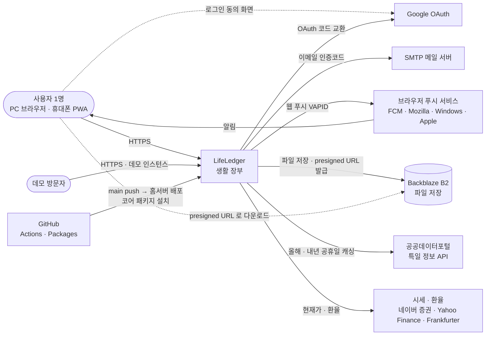
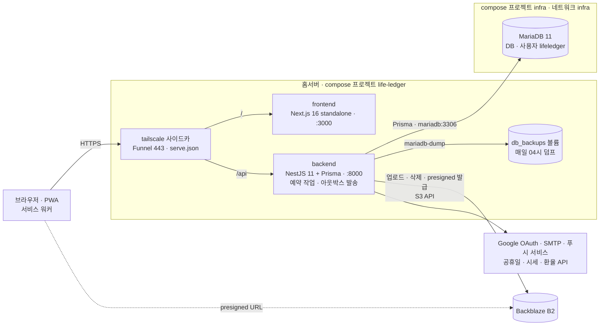

# LifeLedger — Architecture

## Overview

개인 문서·자산·계정 통합 관리 플랫폼

## Stack

| Layer | Tech | 상태 |
| --- | --- | --- |
| Frontend | Next.js 16.2 (App Router), React 19, TypeScript, Tailwind CSS v4 | 구현 완료 |
| 상태관리 | TanStack Query (React Query) — lib/query·queryKeys | 전 페이지 전환 완료 |
| Backend | NestJS 11, TypeScript | 26개 모듈 구현 완료 |
| ORM | Prisma | 구현 완료 |
| DB | MariaDB 11 | 25개 테이블 구현 완료 |
| Auth | Google OAuth 2.0 + JWT (전역 가드 + 새 기기 감지) | 구현 완료 |
| Rate-limit | @nestjs/throttler | 구현 완료 |
| 암호화 | AES-256-GCM(`CRYPTO_KEYS` 키링 + 필드·사용자 AAD, 부팅 시 자동 재암호화, 암호문 컬럼 평문 저장은 Prisma 쓰기 가드가 차단) / 마스터잠금 scrypt | 구현 완료 |
| Storage | Backblaze B2 (@aws-sdk/client-s3, presigned) | 구현 완료 |

## Ports

| Service | Port |
|---------|------|
| Frontend | 3000 |
| Backend | 8000 |
| DB (infra 공용 MariaDB) | 13306 |
| Prisma Studio | 5555 |
| 데모 인스턴스 (홈서버) | frontend 3010 · backend 8010 |

## C4 다이어그램

코드 · 설정에서 확인한 연결만 그렸다 (2026-10-18). 각 연결을 확인한 곳은 아래 표에 있다. 결정의 배경은 [docs/adr/](adr/README.md).

### Level 1 — 시스템 맥락

### Level 2 — 컨테이너

- 화면(`/`)과 API(`/api`)가 같은 origin 이다. 브라우저가 API 를 직접 부른다 — frontend 서버는 backend 를 부르지 않는다(compose 의 `BACKEND_URL` 은 frontend 코드에서 쓰는 곳이 없다).
- 컨테이너 포트는 `127.0.0.1` 에만 열린다. 밖에서는 사이드카로만 들어온다.
- 로컬 개발은 사이드카 없이 frontend `:3000` · backend `:8000` 을 따로 띄운다(같은 호스트 · 다른 포트).
- 데모 인스턴스는 같은 그림을 한 벌 더 띄운 것이다 — 프로젝트 `life-ledger-demo`, 사이드카 `lifeledger-demo`, DB `lifeledger_demo`(같은 MariaDB), 데모 B2 버킷. SMTP · VAPID 는 비운다.

| 연결 | 확인한 곳 |
| --- | --- |
| 사이드카 → frontend · backend, Funnel | `docker-compose.yml` `tailscale` · `tailscale/serve.json` |
| 브라우저 → API (같은 origin) | `frontend/lib/api.ts` 의 `NEXT_PUBLIC_API_URL` |
| backend → MariaDB | `docker-compose.yml` `DATABASE_URL` · 외부 네트워크 `infra` |
| backend → 덤프 볼륨 | `maintenance/db-backup-cron.service.ts` · 볼륨 `db_backups` |
| backend → B2 · 브라우저 → B2 | `file/file.service.ts` (`putObject` · `getDownloadUrl` 5분) · `env.ts` `B2_*` |
| backend → Google | `auth/` (`core-auth` Google 전략) · `env.ts` `GOOGLE_*` |
| backend → SMTP | `mail/` · `env.ts` `SMTP_*` (비면 꺼짐) |
| backend → 푸시 서비스 | `push/webpush.channel.ts` · `push/dto/subscribe.dto.ts`(endpoint 허용 주소) · `env.ts` `VAPID_*` |
| backend → 공휴일 API | `holiday/holiday.service.ts` (`apis.data.go.kr`) |
| backend → 시세 · 환율 | `investment/price-lookup.service.ts` (네이버 · Yahoo · Frankfurter) |
| GitHub → 홈서버 | `.github/workflows/deploy-home-server.yml` (`runs-on: self-hosted`, `NPM_READ_TOKEN`) |

## 데모 인스턴스

같은 코드를 `DEMO_MODE=true` · `NEXT_PUBLIC_DEMO_MODE=true` 로 따로 띄운다(`docker-compose.demo.yml`, DB `lifeledger_demo`, Tailscale `lifeledger-demo`).

- 로그인 화면은 '데모로 둘러보기' 하나 → `POST /auth/demo`(데모 모드에서만 등록되는 라우트)가 데모 사용자 세션을 준다.
- 계정 삭제 · 마스터 잠금 변경/해제는 `assertNotDemo` 가 403 으로 막는다. 파일은 `STORAGE_QUOTA_MB` 한도.
- 매일 KST 04:00 홈서버 crontab 이 `prisma/demo-reset.ts` 로 데이터를 비우고 시드 + 마스터 잠금(`demo1234`)을 다시 건다.
- 운영 절차: `docs/archive/2026-10-13-public-release-plan.md` "5단계 운영 절차".

## 백엔드 모듈

| 모듈 | 경로 prefix | 상태 |
| --- | --- | --- |
| auth | /auth | 구현 완료 |
| transaction | /transactions | 구현 완료 |
| transaction-favorite | /transaction-favorites | 구현 완료 |
| saving | /savings | 구현 완료 |
| investment-account | /investment-accounts | 구현 완료 |
| investment | /investments | 구현 완료 |
| subscription | /subscriptions | 구현 완료 |
| asset | /assets (순자산 요약/추이 — 현금+예적금+투자 집계, 전용 테이블 없음) | 구현 완료 |
| calendar | /calendar (실제 일정 + 구독결제·예적금만기·투자계좌만기 가상 이벤트) | 구현 완료 |
| notification | /notifications (알림 인박스. 알림 생성과 웹푸시 적재를 한 트랜잭션으로 묶는다 — `createWithPush`) | 구현 완료 |
| security | /security (로그인 세션 + 마스터잠금 Vault. 열람 기록은 `/security/access-logs`) | 구현 완료 |
| access-log | (전역, /security/access-logs로 노출) | 구현 완료 |
| settings | /settings | 구현 완료 (프로필 · 데이터 탭) |
| category | /categories | 구현 완료 |
| search | /search | 구현 완료 |
| dashboard | /dashboard (요약·현금흐름예측·D-day) | 구현 완료 |
| credential | /credentials | 구현 완료 |
| file | /files (Backblaze B2) | 구현 완료 |
| export | /export | 구현 완료 |
| import | /import | 구현 완료 |
| maintenance | (크론 — 알림·순자산 스냅샷·DB 백업·투자 현재가 갱신·구독 결제일 갱신·공휴일 사전 캐싱·소프트삭제 항목 자동정리) | 구현 완료 |
| mail | (SMTP 메일 발송 — 이메일 코드 로그인 등, 미설정 시 no-op) | 구현 완료 |
| push | /push (웹 푸시 구독/발송 — VAPID + 발송 아웃박스: 커밋된 것만 발송·멱등키·재시도·원본 에러 보존) | 구현 완료 |
| system-log | /system-logs (백그라운드 작업 실행 로그 — 크론·투자 현재가 갱신 등, 조회 전용) | 구현 완료 |
| health | /health (헬스체크 — 공개, DB 핑) | 구현 완료 |
| meta | /_meta (운영 상태 — 빌드 커밋·설치된 코어 패키지 버전 + 예약 작업 마지막 성공·아웃박스 적체·켜진 알림 채널. 경고는 `warn` 한자리에. 로그인 필요) | 구현 완료 |

## 크론 스케줄러

`@leejinyoung-kr/core-jobs` 기반(2026-09-20 `@nestjs/schedule` 에서 전환), `backend/src/maintenance/`에 위치. 각 작업은 `@Job({ name, cron, leaseMs })` 으로 등록하고, `AppModule` 의 `JobsModule.forRoot({ timeZone: 'Asia/Seoul' })` 가 KST 기준으로 실행한다(컨테이너도 `TZ=Asia/Seoul`). 부팅 로그에 작업 목록과 다음 실행 시각이 찍힌다.

공통 동작(작업 코드에 try/catch·요약 로그를 따로 쓰지 않는다):

- **실행 기록**: 실행마다 `job_run` 1행 — 시작·종료·상태·요약(작업이 돌려준 문자열)·원본 에러. 실패하면 시스템 로그에도 `예약 작업 실패: <작업>`
- **겹침 방지**: 같은 작업이 이미 돌고 있으면 건너뛴다(`running_key` 유니크)
- **lease**: 작업별 제한 시간 안에 끝나지 않으면 `failed(lease_expired)` 로 마감하고 다음 실행을 막지 않는다. 배포·장애로 프로세스가 죽어 `running` 으로 남은 행도 lease 가 지나면 같은 식으로 마감된다
- 사용자별로 도는 작업은 일부 사용자가 실패해도 나머지를 다 처리한 뒤 실행을 실패로 마감한다(`job-result.ts` 의 `finishPerUser` — 사용자별 원인은 시스템 로그).

| 일정 | 작업 이름 · lease | 파일 | 내용 |
| --- | --- | --- | --- |
| 매일 00:05 | `subscription-roll-forward` · 5분 | subscription-cron.service.ts | 결제일(`next_payment_date`)이 오늘(KST)보다 지난 구독을 주기(월/연/주)만큼 넘겨 오늘 이후 첫 결제일로 갱신. 월/연 주기는 원래 결제일(`billing_day`)로 맞추고 그 달에 없으면 말일로 — 31일 결제는 2/28 → 3/31 로 되돌아간다(`billing-date.util.ts`). 체험(`trial`)은 종료일이 지나면 유료 전환으로 보고 `active` 로 바꾸고, 일시정지(`paused`)는 건드리지 않는다. 가계부 자동 등록(`auto_ledger`)이 켜진 구독은 같은 트랜잭션에서 지나간 결제일마다 지출 내역(`subscription_id` 연결, 지운 것 포함 같은 날짜는 건너뜀)을 만든다 — 밤늦게 결제되는 구독이 있어 당일이 아니라 다음 날 넣는다. USD 는 그날 환율로 원화 환산(메모에 원래 금액 · 환율), 환율 조회가 실패하면 그 구독은 결제일도 넘기지 않고 실행을 실패로 마감해 다음 날 다시 한다. 09:00 결제 알림보다 먼저 돈다 |
| 매일 03:00 | `trash-purge` · 10분 | trash-cron.service.ts | soft-delete 후 30일 경과 항목 영구삭제 (거래·예적금·투자·구독·캘린더·계정) + 시스템 로그·작업 실행 기록 90일 경과분 삭제. 휴지통 UI는 없으며 삭제된 항목은 이 크론으로만 정리됨. 테이블 하나가 실패해도 나머지는 계속 지우고 끝에 실패로 마감 |
| 매일 04:00 | `db-backup` · 30분 | db-backup-cron.service.ts | `mariadb-dump` → gzip 압축 후 `backups/`에 저장, 30일 경과 백업 자동 삭제. 실패하면 쓰다 만 파일을 지운다. lease 가 끝나면 `mariadb-dump` 도 함께 종료(signal) |
| 매일 09:00 | `notification-daily` · 10분 | notification-cron.service.ts | 사용자별 알림 생성(예적금·투자계좌 만기 D-30/14/7/1, 구독결제/체험종료 D-7/3/1, 비번회전 90일 경과 후 30일 간격 재알림) + 웹푸시 발송. 매일 반복 알림을 막기 위해 해당 일자에 정확히 일치할 때만 생성. 만기 알림은 설정(`notifMaturity`)으로 토글 가능 |
| 매일 09:00 | `recurring-domestic` · 30분 | recurring-cron.service.ts (`run`) | 반복거래(국내, `transaction.service.ts`의 `materializeRecurring`)는 매일 실행. 반복매수(국내, `investment.service.ts`의 `materializeRecurringBuys`) + 국내 투자 종목 현재가 갱신(`refreshCurrentValues`)은 실제 증권시장이 열리는 평일(KST 기준, `isWeekdayKST()`)에만 실행하고 주말엔 건너뜀. 전체 사용자를 순회하며, 사용자별 실패는 시스템 로그에 남기고 계속 진행한 뒤 실행은 실패로 마감. 반복거래/반복매수는 서로 독립적으로 처리 건수를 집계해 완료 로그도 따로 남기며, 처리한 항목이 0건이고 실패도 없으면 그 로그는 남기지 않는다. 반복매수는 종목별로 외부 시세조회 API(네이버/야후)를 호출하므로 3종목씩 묶어 묶음 사이 3초 대기(현재가 갱신은 5종목씩 2초 대기) |
| 매일 23:00 | `recurring-foreign` · 30분 | recurring-cron.service.ts (`runForeign`) | 반복매수(해외 — foreign_stock/foreign_etf) 회차 일괄 생성 + 해외 투자 종목 현재가 갱신. 미국 장이 열린 직후 실시간 가격으로 매수하도록 국내 배치와 시간을 분리. 평일(KST 기준)에만 실행하고 주말엔 건너뜀(실행 기록 요약에만 `주말 — 건너뜀`). 처리한 반복매수가 0건이고 실패도 없으면 완료 로그를 남기지 않는다 |
| 매일 01:00 | `net-worth-snapshot` · 10분 | net-worth-snapshot-cron.service.ts | 사용자별 **어제가 속한 달**(YYYY-MM) 이름으로 지금 총자산(현금+예적금+투자)·현금 총액(`cash_total`)을 upsert — 같은 달엔 매일 덮어써서 다음 달 1일 새벽 저장이 월말 값이 된다(예적금·투자는 이력이 없어 지금 값만 찍을 수 있으므로 이름표는 찍은 시점의 달). `total_debt`는 부동산/부채 기능 제거 이후 항상 0, 과거 기록값은 유지. `cash_total`(현금 = 수입 − 지출 − 자산이동)은 자산 요약 API(`/assets/summary`)가 전체 거래를 매번 재집계하지 않고 직전 월말 스냅샷 + 이후 거래 델타로 계산하는 기준점. 2026-10-14 전에는 매주 월요일에 지난달 이름으로 지금 값을 덮어써 이름표가 한 달 밀렸다 — 마이그레이션 `20261014090000_fix_net_worth_snapshot_label_and_cash` 가 바로잡음 |
| 매월 1일 02:00 | `holiday-prefetch` · 5분 | holiday-cron.service.ts | 올해·내년 공휴일을 미리 캐싱(공공데이터포털 특일 정보 API) — 캘린더를 열 때 외부 호출이 없게 한다 |

> 작업별 실행 기록은 `job_run` 테이블(시작·종료·상태·요약·원본 에러)에, 사용자에게 보여줄 완료·실패는 `SystemLogService`를 통해 `/system-logs`(`/logs` 화면)에도 기록된다. 실행 기록이 실패로 마감되면 `/logs` 에 `예약 작업 실패: <작업>` 이 남는다.

## 프론트엔드 페이지

| 경로 | 상태 |
| --- | --- |
| /login | 구현 완료 |
| /dashboard | 구현 완료 |
| /transactions | 구현 완료 |
| /networth | 구현 완료 |
| /subscriptions | 구현 완료 |
| /calendar | 구현 완료 |
| /notifications | 구현 완료 |
| /security | 구현 완료 (보안 — 로그인 세션 · 보안 설정 · 최근 열람) |
| /settings | 구현 완료 |
| /codes | 구현 완료 |
| /credentials | 구현 완료 (백엔드 연동) |
| /files | 구현 완료 (Backblaze B2) |
| /logs | 구현 완료 (백엔드 연동) |

> 모든 페이지·공통 컴포넌트는 React Query(useApiQuery/useApiMutation) 기반. 인증(401 refresh)·마스터잠금(423 unlock)은 lib/api 래퍼가 처리.
